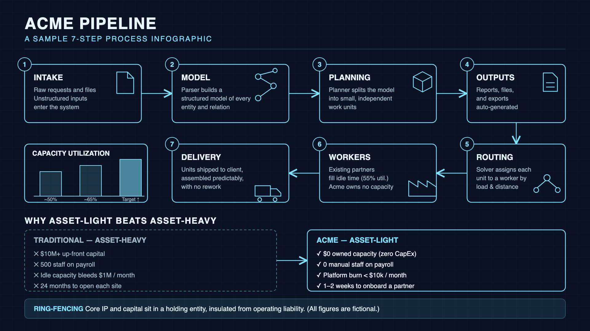

# infographic-builder

An agent skill for building clean, editable **infographics and mechanism diagrams** without relying on hosted image APIs.

**SVG owns layout and text. Local image models only make small, transparent PNG assets.** Diffusion models garble small text, so they never draw labels, numbers or charts.



*Example output (`examples/example_flow.svg`, all figures fictional).*

## What's inside

| Path | Purpose |
|---|---|
| `SKILL.md` | The skill: workflow, SVG design rules, local-model guidance, QA checklist |
| `scripts/render.sh` | SVG to PNG at exact size (rsvg-convert, then headless Chrome, then inkscape, then cairosvg) |
| `scripts/make_asset.py` | Raw generated image to small transparent, optionally monocolor PNG asset |
| `templates/flow_snake.svg` | 1920x1080 numbered-flow layout with chart, comparison and footer |
| `examples/` | Rendered example |

## Workflow

1. Extract steps, numbers and a comparison from your source material.
2. Pick a layout from `templates/` and edit the SVG.
3. (Optional) Generate small assets with a local model (mflux/FLUX, DiffusionKit, diffusers, ComfyUI), then:
   ```bash
   python3 scripts/make_asset.py raw.png assets/icon.png --size 256 --mono "#7fe3ff"
   ```
4. Embed with `<image href="assets/icon.png" x=".." y=".." width="72" height="72"/>`.
5. Render and check visually:
   ```bash
   bash scripts/render.sh my.svg my.png 1920 1080
   ```

If no local image model is available, draw assets as inline SVG paths. The result is still transparent and monocolor.

## Install

Copy the folder into your agent's skills directory, for example:

```bash
# Antigravity / Gemini-style global skills
git clone https://github.com/<you>/infographic-builder ~/.gemini/config/skills/infographic-builder
```

Any agent that reads `SKILL.md` (YAML front matter plus Markdown) can use it.

## Requirements

- A renderer: `rsvg-convert`, Google Chrome (headless), `inkscape` or `cairosvg`
- For assets: `pip install pillow` (optional: `rembg`, `pngquant`)
- Optional local image model of your choice

> Tip: on macOS don't use `qlmanage -t` for SVG to PNG. It returns a cropped square thumbnail.

## License

MIT
